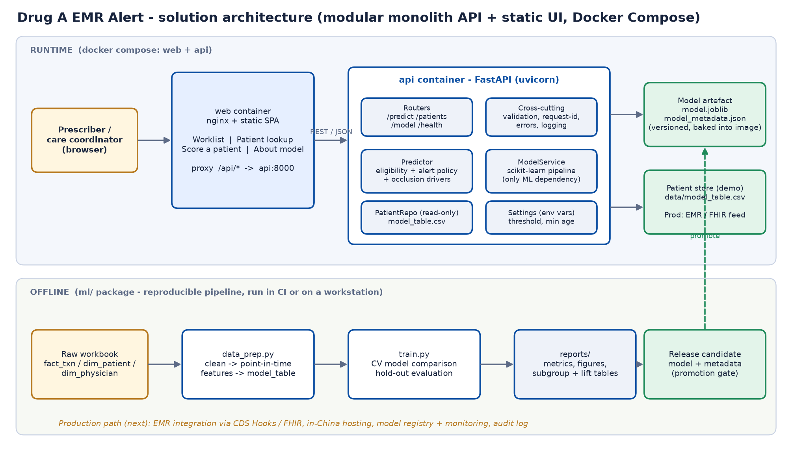

# Architecture (Step 4a)

## Layers and responsibilities
| Layer | Tech | Responsibility |
|---|---|---|
| UI (`frontend/`) | Vanilla ES modules, no build step, nginx | Worklist of alerted patients, patient lookup with reasons + EMR-alert preview, what-if scorer, model transparency page. Escapes all output via DOM APIs (no `innerHTML`). |
| API (`backend/app/api`) | FastAPI | Routing, request/response schemas, OpenAPI. No business logic. |
| Domain (`services/decision.py`, `predictor.py`) | pure Python | Eligibility rules, alert policy, tiers, driver explanations. Unit-tested without a model. |
| Inference (`services/model_service.py`) | scikit-learn | The only module that loads/uses the model; validates feature order; maps failures to typed errors. |
| Data access (`services/patient_repo.py`) | pandas | Read-only patient lookup (demo stand-in for an EMR/FHIR feed). |
| Cross-cutting (`core/`) | pydantic-settings | Config via `EMRALERT_*`, uniform error envelope, request ids, structured logs. |
| Offline ML (`ml/`) | pandas, scikit-learn | `data_prep.py` (clean + point-in-time features) and `train.py` (CV comparison, evaluation, export). Shares feature definitions with serving via `ml/features.py` and `model_metadata.json`. |

## Request flow (`POST /api/v1/predict`)
Browser -> nginx `/api/` -> FastAPI validation (422 envelope on failure) -> `Predictor` -> `ModelService.predict_proba` -> `decision.eligibility/tier/should_alert` -> occlusion drivers -> JSON with `likelihood_treated`, `tier`, `eligible`, `alert`, `drivers`, `model_version`.

## Error handling
Typed `AppError`s map to 404/422/503; unhandled exceptions return a generic 500 with a `request_id` and are logged with a stack trace; start-up failures leave the API running in `degraded` mode (`/health`), prediction endpoints answer `503 model_unavailable`; UI shows the message and request id and never a blank screen.

## Scalability path
Stateless API (scale horizontally); batch endpoint (`/predict/batch`, max 1,000) for EMR bulk jobs; replace `PatientRepo` with a feature-store/FHIR client; load model by version from a registry; add auth (OIDC), audit logging and rate limiting at the gateway; deploy in-China region.

## Production gaps (deliberately out of scope for the exercise)
Authentication/authorisation, audit trail of every alert shown/acted on, EMR integration (CDS Hooks/FHIR), PHI minimisation, monitoring dashboards, load testing, SaMD/clinical-safety review.
