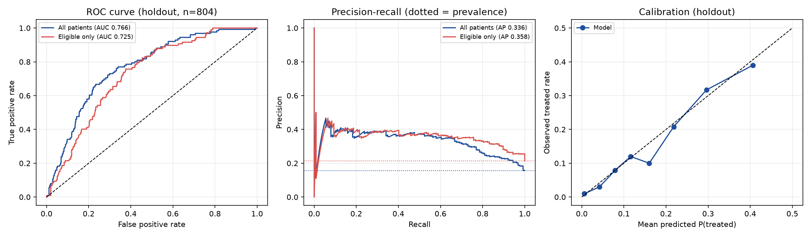
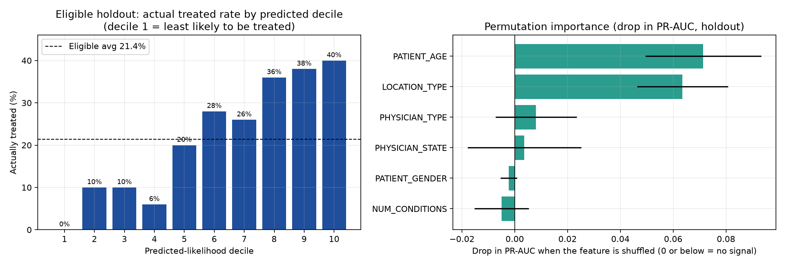

# Model report - Steps 1 to 3 (data cleaning, dataset, model)

All numbers below are reproducible: `python ml/data_prep.py <workbook.xlsx> data` then `python ml/train.py data/model_table.csv models reports`. Raw logs: `data/data_quality_log.json`, `reports/metrics.json`.

## 1. Data review and cleaning (Step 1)

| Check | Finding | Action |
|---|---|---|
| Size | `fact_txn` 115,274 rows; 4,020 patients (all appear in `dim_patient`); 25,343 physicians | - |
| Referential integrity | 0 orphan patient IDs, 0 orphan physician IDs, no duplicate dimension keys | none needed |
| Inconsistent casing in `TXN_DESC` | 53 distinct raw values collapse to 25 (e.g. `fatigue` / `FATIGUE`, `Low_Contraindication`) | trimmed + upper-cased all text columns |
| Duplicates | 152 exact duplicates; 233 after case normalisation | dropped (115,041 rows remain) |
| Location type | 48 raw values incl. synonyms (`CLINIC - RURAL HEALTH` vs `RURAL HEALTH CLINIC`, `UNASSIGNED`), 15,795 null | synonyms merged, null/unassigned -> `UNKNOWN` (40 clean values) |
| Missing physician on a transaction | 9,586 (cleaned) | kept; patients with no physician on the diagnosis day -> `UNKNOWN` (579 patients) |
| Physician demographics | 4,304 missing birth year; 21 implausible (<1930); 2 missing state | implausible -> null; state -> `UNKNOWN` |
| Patient gender | only M/F in the sample (dictionary also allows U) | `U` handled in code and API |
| Timeline | Disease X records all in 2022; first diagnosis dates 1 Apr - 30 Jun 2022 (95% in June); 7,811 records dated after first diagnosis | post-diagnosis records never used as features (leakage) |
| Treatment timing | 631 patients have Drug A; 456 on the first diagnosis day; 65 have Drug A *before* their first Disease X record (up to 50 days); 2 more than 5 days after | kept as `TARGET=1`; flagged to data owner |

## 2. Model dataset (Step 2)

`data/model_table.csv`: **4,020 rows, one per `PATIENT_ID` (verified unique)**; first nine columns follow the `model_table` layout exactly, extra engineered columns follow.

Assumptions (all open to challenge):
- `DISEASEX_DT` = earliest Disease X record. `PATIENT_AGE` = year(`DISEASEX_DT`) - `BIRTH_YEAR`.
- `NUM_CONDITIONS` = distinct qualifying high-risk conditions on or before `DISEASEX_DT`: diabetes, heart disease, immunocompromised, obesity. Hypertension and mental-health disorders are not on the brief's list so are excluded; lung disease, cancer and smoking are on the list but not in the data.
- `PHYSICIAN_TYPE`, `PHYSICIAN_STATE`, `LOCATION_TYPE` come from the diagnosing encounter (first-day Disease X record, preferring rows with a physician).
- `TARGET` = patient has any Drug A treatment record.

**Additional features (brief asks for >= 2)** - 18 added: care-setting and prescriber context (`PHYSICIAN_GROUP`, `IS_TELEHEALTH`, `INSURANCE_TYPE`, physician age/gender), clinical context (`HAS_*` condition flags incl. hypertension and mental health, `NUM_SYMPTOMS`, `SYMPTOMS_LAST_5D`, `HAS_RESP_SYMPTOM`, `CONTRAINDICATION_LEVEL` 0-3), utilisation (`NUM_PRIOR_ENCOUNTER_DAYS`, `NUM_DX_VISITS_TO_DATE`), and `IS_AGE_65_PLUS`, `ELIGIBLE`. See `docs/data_dictionary_model_table.md`.

## 3a. Model (Step 3a)
Four candidate models x four feature sets, repeated stratified 5-fold CV (3 repeats) on the 80% training split (n=3,216); metric = PR-AUC (prevalence 15.7%). Top CV PR-AUC 0.361 (HistGB, core+clinical extras); four candidates are within one standard error, so the **simplest within 1 SE was chosen: HistGB on the six core features** (CV ROC-AUC 0.756, PR-AUC 0.359). Full table: `reports/model_comparison_cv.csv`. Final model is refit on all 4,020 patients for serving; the 20% hold-out (n=804) is used only for the numbers below.

## 3b. Why this model
- Tabular data with mixed categorical + numeric features and a non-linear age effect (treatment peaks at 65-74) -> gradient-boosted trees are the standard strong baseline and need no hand-crafted transforms.
- It beat logistic regression, logistic+age-spline and random forest on CV PR-AUC and log-loss, but only slightly: **the honest reading is that signal is limited and model family matters less than features/data.** We therefore prefer the simplest feature set and keep the model small and fast.
- Output is a probability, so the alert threshold is a business dial (alert burden vs. coverage) rather than a retrain.
- Trade-offs accepted: less transparent than logistic regression (mitigated with occlusion-based per-patient drivers and permutation importance); depends on historical prescribing behaviour (see limitations).

## 3c. Performance (Step 3c) - 20% hold-out
| Slice | n | Actually treated | ROC-AUC (95% CI) | PR-AUC (95% CI) | Brier |
|---|---|---|---|---|---|
| All patients | 804 | 15.7% | **0.766** (0.721-0.808) | **0.336** (0.274-0.420) | 0.117 (prevalence-only 0.132) |
| Eligible (age>12 and high-risk) | 501 | 21.4% | **0.725** | **0.358** | 0.153 |

Reference points: age alone gives ROC-AUC 0.670; random = 0.5, PR-AUC baseline = prevalence.

- **Ranking works:** on eligible hold-out patients the least-likely decile was treated 0% of the time and the bottom three deciles 7%; the top three deciles 38% (vs 21% average).
- **Calibration** is reasonable across the range (right panel); no separate calibration layer needed.
- **Drivers (permutation importance):** age and care setting dominate; physician specialty adds a little; the clinical extras and `NUM_CONDITIONS` add nothing measurable on top of them.
- **Alert operating point (threshold 15%, eligible hold-out):** 171/501 (34%) alerted; 93.6% of alerted patients were untreated (vs 78.6% base rate -> 1.19x); 11 alerted patients were treated anyway; 40.6% of all untreated eligible patients are caught. Other thresholds: `reports/alert_operating_points.csv`.
- **Subgroups** (`reports/subgroup_performance.csv`): similar discrimination for F/M (0.74/0.80) and age bands (0.67-0.71); weakest where the diagnosing physician is unknown (0.57) - the model essentially says "no prescriber -> untreated".

## Limitations and what I would do with more time
1. **Small, single-window sample** (4,020 patients; one quarter): CIs are wide (ROC-AUC 0.72-0.81). Needs temporal and site-level validation on a larger extract before any commitment.
2. **Learns prescribing behaviour, not clinical appropriateness.** "Unlikely to be treated" may be clinically right (severity, interacting drugs). Severity and hospitalisation are not in the data; 66% of in-sample alerts are urgent-care / ER / inpatient / lab diagnoses where Drug A (mild-moderate, outpatient) may not apply. Add severity features and suppress inpatient before launch.
3. **Alert routing:** 31% of alerts (297 of 966) have no physician ID on the diagnosis day (39% independent lab, 35% urgent care; 6% treated, 18 of 297). Alerts = eligible patients with P(treated) < 0.15 over all 2,507 eligible patients (model scored in-sample). They need a care-coordinator / ordering-physician route, not an EMR pop-up.
4. **Counter-intuitive signal:** patients with *recorded* contraindications were treated more (23% vs 13%), most likely because richer medication records mark engaged patients (data-capture artefact), so contraindication is not a reliable "don't alert" rule here.
5. **Data origin:** the sample is US-style (states, Medicare/Medicaid). A China deployment must retrain on in-China EMR data; nothing here transfers as a model.
6. Next modelling steps: physician-level trailing prescribing rate (likely the biggest lift), severity and lab features, temporal back-test, fairness audit by hospital tier/region, uplift modelling (who responds to a nudge) instead of propensity-to-be-treated.
